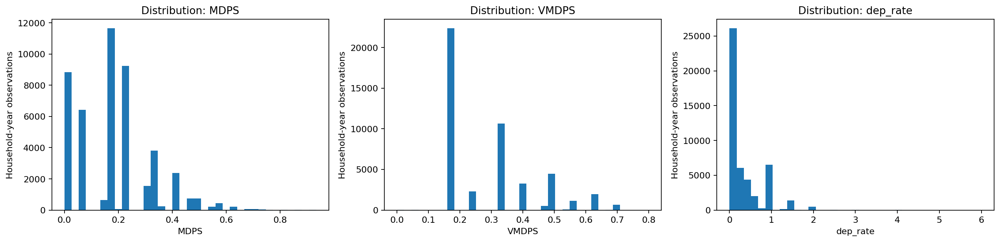
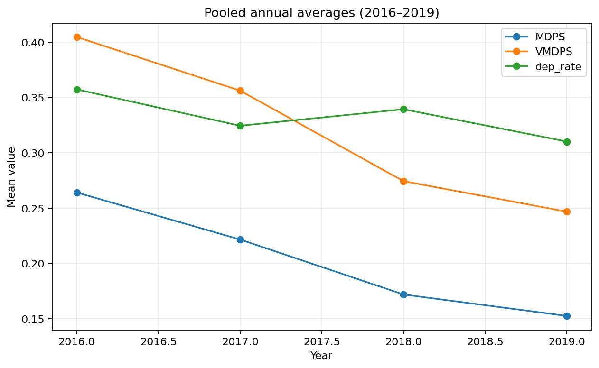

# FinPulse India
## Household Financial Vulnerability State Tracking using Hidden Markov Models

**Project Domain:** Machine Learning — Sequential Data  
**Core Algorithm:** Gaussian Hidden Markov Model (Gaussian HMM)  
**Dataset Period:** 2016–2019  
**Unit of Analysis:** Household-year observation  
**Case Study:** Impact of Microcredit on Multidimensional Poverty and Vulnerability in India

---

## 1. Project Overview

FinPulse India is an exploratory machine learning project that studies how household vulnerability profiles evolve across consecutive annual observations.

Household financial vulnerability is multidimensional. A household's condition cannot necessarily be represented by a single poverty indicator or one year's observation. Its observed poverty and dependency indicators may change over time, while the underlying vulnerability profile is not directly observable.

FinPulse addresses this problem using a **Gaussian Hidden Markov Model (HMM)**. The model identifies latent household states from observed indicators and estimates the probability of transitioning between these states over consecutive years.

Unlike static grouping methods, the HMM explicitly models temporal dependence and provides a probabilistic representation of state persistence and transitions.

> **Project scope:** FinPulse is an exploratory household vulnerability-state analysis. It is not a loan-default prediction system, credit-scoring product, or causal evaluation of microcredit.

### Research Question

Can a Hidden Markov Model identify latent household vulnerability profiles and estimate how these profiles persist or change across consecutive annual observations?

### Project Objectives

1. Prepare household observations as correctly ordered annual sequences.
2. Analyse multidimensional poverty, vulnerability, and dependency indicators.
3. Identify latent household states using a Gaussian HMM.
4. Estimate transition probabilities between hidden states.
5. Decode the most likely state sequence using Viterbi.
6. Estimate posterior state probabilities to represent uncertainty.
7. Visualise state distributions, feature profiles, annual trends, and transitions.

---

## 2. Dataset Description

The project uses an analytical dataset associated with the research study:

**Impact of Microcredit on Multidimensional Poverty and Vulnerability in India**

**Authors:** Rasmita Maharana and Tara Shankar Shaw  
**Data source:** Consumer Pyramid Household Survey (CPHS) analytical dataset  
**Period analysed:** 2016–2019

### Dataset Statistics

| Metric | Value |
|---|---:|
| Original records | 47,437 |
| Original columns | 115 |
| Unique households | 32,880 |
| Survey years | 2016–2019 |
| Eligible observations used for HMM inference | 21,679 |
| Consecutive sequence segments | 9,669 |
| Training sequences | 2,000 |
| Training observations | 4,436 |

The original dataset contains more variables than the model requires. FinPulse uses three selected indicators as its baseline observation vector.

### Selected Features

| Feature | Description | Purpose |
|---|---|---|
| `MDPS` | Multidimensional Poverty Score | Represents observed multidimensional poverty |
| `VMDPS` | Vulnerability to Multidimensional Poverty Score | Represents observed vulnerability |
| `dep_rate` | Household dependency rate | Represents household dependency structure |

The observation vector at time \(t\) is:

\[
X_t = [MDPS_t,\ VMDPS_t,\ dep\_rate_t]
\]

Borrowing-related variables are not used as direct observations in the baseline HMM. Borrowing alone should not be treated as proof of financial distress.

### Data Quality and Preparation

The preprocessing workflow includes:

- Validation of household identifiers and year values.
- Checking duplicate household-year records.
- Conversion of selected features to numeric values.
- Removal of observations with missing required fields.
- Sorting observations by household and year.
- Construction of consecutive annual sequence segments.
- Exclusion of singleton segments from transition-based fitting.
- Standardisation of model input features.

**Important:** If a household is observed in 2016 and 2018 but not 2017, those observations are not treated as consecutive. The sequence is split rather than inventing a one-year transition.

---

## 3. Why a Hidden Markov Model?

The main challenge is that the actual vulnerability state of a household is not directly observed.

We can observe MDPS, VMDPS, and dependency rate, but these indicators do not directly reveal a household's underlying vulnerability regime.

A Hidden Markov Model is appropriate because it separates:

- **Observed variables:** The household indicators recorded in each survey year.
- **Hidden states:** Latent vulnerability profiles inferred by the model.
- **Transition probabilities:** The probability of moving from one hidden state to another.
- **Emission distributions:** The probability of observing a feature vector given a hidden state.

The model represents the hidden-state process as:

\[
P(z_t=j \mid z_{t-1}=i)=a_{ij}
\]

The observation process is represented by a Gaussian emission distribution:

\[
X_t \mid z_t=k \sim \mathcal{N}(\mu_k,\Sigma_k)
\]

This allows FinPulse to model both the observed household indicators and the temporal behaviour of the latent states.

### Why This Fits the Problem

| Project requirement | HMM capability |
|---|---|
| Underlying vulnerability is not directly observed | Infers latent states |
| Indicators are continuous numerical values | Supports Gaussian emissions |
| Household observations have a time order | Models state transitions |
| Household conditions may persist across years | Estimates self-transition probabilities |
| State assignments involve uncertainty | Provides posterior state probabilities |
| Multiple possible state paths exist | Uses Viterbi decoding to find the most likely path |

The algorithm was selected because its modelling assumptions match the research question, not because it has been proven superior to every other Unit 4 method through a benchmark experiment.

---

## 4. Comparison with Machine Learning Unit 4 Algorithms

Unit 4 covers sequential data, Markov models, Hidden Markov Models, Maximum Likelihood Estimation, Expectation-Maximization, Forward–Backward, Viterbi, scaling factors, and Linear Dynamical Systems.

The following comparison explains why the HMM is suitable for FinPulse.

| Unit 4 method | Main purpose | Limitation for this project | Relevance to FinPulse |
|---|---|---|---|
| Finite-window / lagged prediction | Predicts a future value using previous observations | Focuses on forecasting observed values rather than discovering latent vulnerability regimes | Useful for a separate forecasting extension |
| Markov Chain | Models transitions between observable or predefined discrete states | Requires states to be known or discretised before transition modelling | Provides the transition concept used by the HMM |
| Hidden Markov Model | Infers hidden states from observed emissions and models state transitions | Requires assumptions about hidden-state dynamics and emission distributions | **Selected method** |
| Maximum Likelihood Estimation | Estimates parameters that maximise data likelihood | Does not independently solve the latent-state sequence problem | Provides the statistical estimation objective |
| Baum–Welch / EM | Iteratively learns HMM parameters using expected hidden-state assignments and transitions | Can converge to a local optimum and depends on initialisation | Used for HMM parameter learning |
| Forward–Backward | Calculates sequence likelihoods and posterior state probabilities | Does not independently provide the single most likely global state path | Used for probabilistic inference |
| Viterbi | Finds the most likely hidden-state sequence | Produces one best path rather than the full uncertainty distribution | Used to decode household state sequences |
| Linear Dynamical System / Kalman Filter | Models continuous hidden states with linear Gaussian dynamics | Assumes continuous latent dynamics rather than a small set of discrete vulnerability regimes | A possible alternative if continuous latent vulnerability trajectories are the objective |

### 4.1 Markov Chain vs Hidden Markov Model

A standard Markov Chain models transitions between states that are already observable or defined.

For example, a conventional Markov Chain could model transitions between predefined categories such as:

- Low vulnerability
- Moderate vulnerability
- High vulnerability

However, those categories would need to be defined before estimating the transition matrix.

FinPulse does not begin with verified vulnerability-state labels. Instead, it uses observed household indicators to infer the underlying states.

An HMM therefore provides two connected components:

1. An emission model that links observed indicators to hidden states.
2. A transition model that estimates how hidden states change over time.

This is the key reason for choosing an HMM instead of using a standard Markov Chain alone.

### 4.2 HMM vs Linear Dynamical Systems

A Linear Dynamical System (LDS) uses a continuous latent state and linear Gaussian state and observation equations. Kalman filtering estimates the evolving hidden state.

FinPulse's objective is different: it seeks a small number of interpretable discrete vulnerability profiles and the probabilities of moving between them.

An HMM is therefore a more direct match for the project's discrete latent-regime objective.

### 4.3 Algorithms Used Inside the HMM

The following Unit 4 algorithms are not competing alternatives to the HMM. They perform different tasks within the HMM workflow.

| Algorithm | Function in FinPulse |
|---|---|
| Baum–Welch / EM | Learns initial-state, transition, and emission parameters |
| Forward algorithm | Evaluates the likelihood of an observed sequence |
| Backward algorithm | Supports posterior state inference |
| Forward–Backward | Estimates posterior probabilities of hidden states |
| Viterbi | Decodes the most likely hidden-state sequence |
| Scaling / log probabilities | Helps maintain numerical stability during sequence calculations |

This distinction is important: **the Gaussian HMM is the model; EM, Forward–Backward, and Viterbi are algorithms used to train, evaluate, and decode it.**

---

## 5. Model Architecture and Implementation

The project follows this pipeline:

```text
CPHS Analytical Dataset
          |
          v
Data Validation and Cleaning
          |
          v
Select MDPS, VMDPS, dep_rate
          |
          v
Group by HH_ID and Sort by Year
          |
          v
Construct Consecutive Sequences
          |
          v
StandardScaler
          |
          v
Gaussian Hidden Markov Model
          |
          +----------------------+
          |                      |
          v                      v
   Baum-Welch / EM        Forward-Backward
   Parameter Learning    Posterior Probabilities
          |                      |
          +----------+-----------+
                     |
                     v
               Viterbi Decoding
                     |
                     v
          Hidden-State Assignments
                     |
                     v
         State Profiles and Transition
                  Analysis
                     |
                     v
             Results and Graphs
```

### Model Configuration

| Parameter | Recorded configuration |
|---|---|
| Model | Gaussian HMM |
| Number of hidden states | 3 |
| Training method | Baum–Welch / EM |
| Feature scaling | StandardScaler |
| Training sequences | 2,000 |
| Training observations | 4,436 |
| Inference observations | 21,679 |
| Random initialisation | Seed-based |
| Recorded EM iterations | 49 |
| Recorded training convergence | Yes |

The recorded reference run uses Gaussian emissions and a tied covariance configuration. The covariance-selection caveat is documented in Section 8.

---

## 6. Results and Findings

The following are recorded reference outputs from the completed project run.

### 6.1 Model and Inference Results

| Metric | Result |
|---|---:|
| Original analytical records | 47,437 |
| Eligible inference observations | 21,679 |
| Consecutive sequence segments | 9,669 |
| Hidden states | 3 |
| Training sequences | 2,000 |
| Training observations | 4,436 |
| EM iterations | 49 |
| Training convergence | Yes |

### 6.2 Hidden-State Distribution and Profiles

The fitted model identified three latent states.

| State | Observations | Mean MDPS | Mean VMDPS | Mean Dependency Rate | Descriptive Profile |
|---|---:|---:|---:|---:|---|
| State 0 | 6,936 | 0.18229 | 0.35039 | 0.27089 | Intermediate MDPS–VMDPS profile |
| State 1 | 4,455 | 0.29816 | 0.55339 | 0.33228 | Higher MDPS–VMDPS profile |
| State 2 | 10,288 | 0.12273 | 0.17269 | 0.29424 | Lower MDPS–VMDPS profile |

These profiles are descriptive interpretations of the observed feature means. They are not official poverty classifications.

State numbers are algorithmic identifiers, not an inherent ranking of household welfare.

### 6.3 Learned Transition Matrix

The transition matrix estimates the probability of moving from one hidden state to another across consecutive observed years.

| From / To | State 0 | State 1 | State 2 |
|---|---:|---:|---:|
| State 0 | 0.7136 | 0.0451 | 0.2413 |
| State 1 | 0.4528 | 0.4396 | 0.1076 |
| State 2 | 0.0640 | 0.0064 | 0.9296 |

Each row represents a probability distribution and sums to approximately 1.

**Interpretation:**

- State 2 has a high estimated self-transition probability of 0.9296, indicating strong persistence within this fitted model.
- State 1 has an estimated 0.4528 probability of transitioning to State 0.
- State 0 has an estimated 0.7136 probability of remaining in State 0.
- The matrix describes estimated transitions, not guaranteed future outcomes or causal effects.

---

## 7. Visualisations

The notebook generates visualisations to support the analysis and interpretation of the model.

Store the exported images in the repository's `graphs/` directory.

### 7.1 Feature Distributions

Shows the distributions of MDPS, VMDPS, and dependency rate before modelling.



### 7.2 Annual Trends

Shows the pooled annual averages of the selected household indicators from 2016 to 2019.



### 7.3 Hidden-State Distribution

Shows the number or percentage of household-year observations assigned to each inferred state.


### 7.4 State Profiles

Compares the mean MDPS, VMDPS, and dependency rate across the three inferred states.


### 7.5 Transition Matrix

Visualises the model-estimated probabilities of transitions between hidden states.


*Note: The image links above assume these filenames are present in `graphs/`. Update the paths if your exported graph filenames differ.*

---

## 8. Model Selection and Validation

The project notebook records a comparison between diagonal and tied Gaussian covariance configurations.

| Covariance Configuration | Log-Likelihood | Parameters | AIC | BIC |
|---|---:|---:|---:|---:|
| Diagonal | 3770.7971 | 26 | -7489.5942 | -7323.2590 |
| Tied | -15915.9627 | 23 | 31877.9255 | 32025.0682 |

For models fitted and evaluated on the same observations under comparable conditions, lower AIC and BIC values are preferred.

The recorded comparison favours the diagonal covariance configuration. However, the reference state profiles and 49-iteration convergence results are documented for the tied-covariance run.

**This is a validation issue that must be resolved before making a final model-selection claim.** Both covariance configurations should be rerun using the same:

- Training observations
- Feature scaling
- Sequence lengths
- Initialisation strategy
- Scoring procedure

The final report should identify which configuration was retained after this controlled comparison. Do not claim that tied covariance is the statistically preferred configuration based on the current recorded comparison.

---

## 9. Repository Structure

The repository is organised to keep the dataset, notebook, visualisations, and exported results separate.

```text
FinPulse/
│
├── README.md
├── requirements.txt
│
├── notebooks/
│   └── FinPulse_India_Project_Walkthrough.ipynb
│
├── data/
│   └── Final_Analytical_data_file.dta
│
├── graphs/
│   ├── 01_feature_distributions.png
│   ├── 02_annual_trends.png
│   ├── 03_state_distribution.png
│   ├── 04_state_profiles.png
│   └── 05_transition_matrix.png
│
├── results/
│   ├── household_state_inference.csv
│   ├── state_profiles.csv
│   ├── transition_matrix.csv
│   ├── annual_state_composition.csv
│   ├── finpulse_gaussian_hmm.joblib
│   └── finpulse_scaler.joblib
│
└── docs/
    └── project_documentation.md
```

Only include files that actually exist in the repository. If the dataset's licence does not permit redistribution, provide the source and access instructions rather than uploading the raw dataset.

---

## 10. Installation and Reproducibility

### Requirements

Install the dependencies using:

```bash
pip install -r requirements.txt
```

### Run the Notebook

1. Clone the repository.
2. Install the dependencies.
3. Open the notebook in Google Colab or Jupyter.
4. Provide the original `.dta` dataset when prompted.
5. Run the notebook cells in order.
6. Review the data-quality checks, model configuration, state profiles, and transition matrix.
7. Export the results and visualisations.

The reference implementation trains on 2,000 eligible sequence segments to control training time and then performs inference on all eligible observations.

A fresh execution may produce slightly different results depending on the data, sample, package versions, and model initialisation. The recorded reference results in this README should therefore be distinguished from newly generated outputs.

---

## 11. Limitations and Responsible Interpretation

FinPulse is an exploratory unsupervised sequence-modelling project. Its results must be interpreted within the limits of the data and model.

### Dataset Limitations

- The dataset is an analytical matched sample and does not automatically represent every household in India.
- The household panel is unbalanced.
- Annual observations do not provide monthly financial behaviour.
- The dataset does not contain verified loan-default labels or monthly repayment histories.

### Model Limitations

- Hidden states are inferred statistical regimes, not ground-truth poverty categories.
- State identifiers may change between model fits.
- The Gaussian emission assumption may not perfectly represent bounded or zero-inflated variables.
- The first-order Markov assumption limits the direct dependence of the next hidden state to the current hidden state.
- Singleton sequence segments cannot contribute within-sequence transitions.
- A three-state model is a modelling choice that should be checked for stability and interpretability.

### Claims This Project Does Not Make

FinPulse does not:

- Predict loan default or repayment failure.
- Prove that a household is officially poor or financially distressed.
- Establish that microcredit caused a household's vulnerability to change.
- Guarantee a household's future state.
- Claim classification accuracy against unobserved ground-truth labels.

---

## 12. Conclusion

FinPulse India demonstrates the application of probabilistic sequence modelling to household vulnerability analysis.

Using annual household observations from the 2016–2019 CPHS analytical dataset, the project constructs consecutive household sequences and applies a Gaussian Hidden Markov Model to infer latent vulnerability profiles.

The model combines Gaussian emission distributions with a transition matrix, allowing the analysis to move beyond static grouping and examine how inferred household states persist or change over time.

Baum–Welch / EM supports parameter learning, Forward–Backward estimates posterior state probabilities, and Viterbi decoding identifies the most likely hidden-state sequence.

**Core contribution:** FinPulse applies the concepts of sequential data, Markov models, hidden states, probabilistic inference, and temporal transitions from Machine Learning Unit 4 to a real-world household vulnerability research problem.
